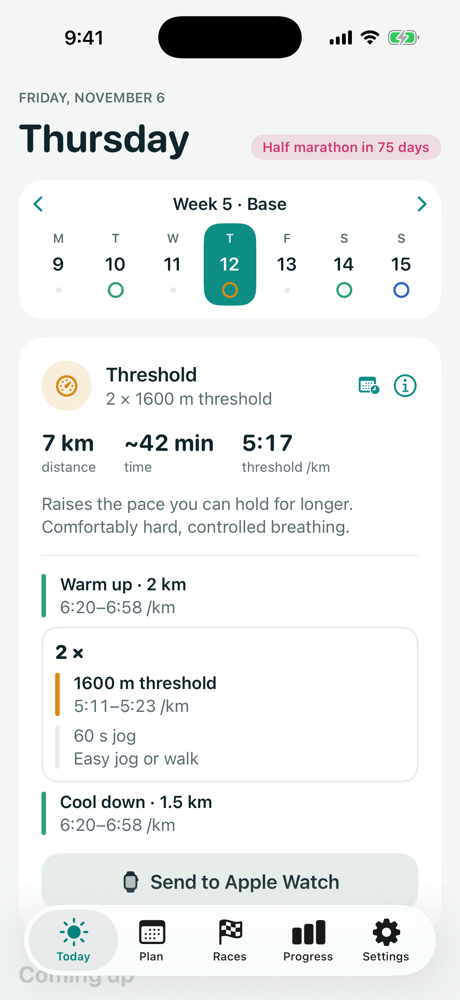
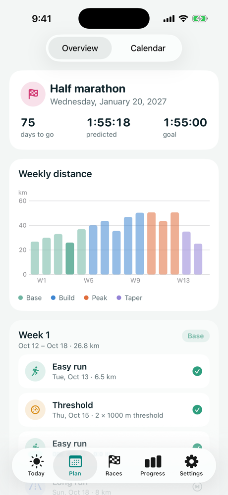
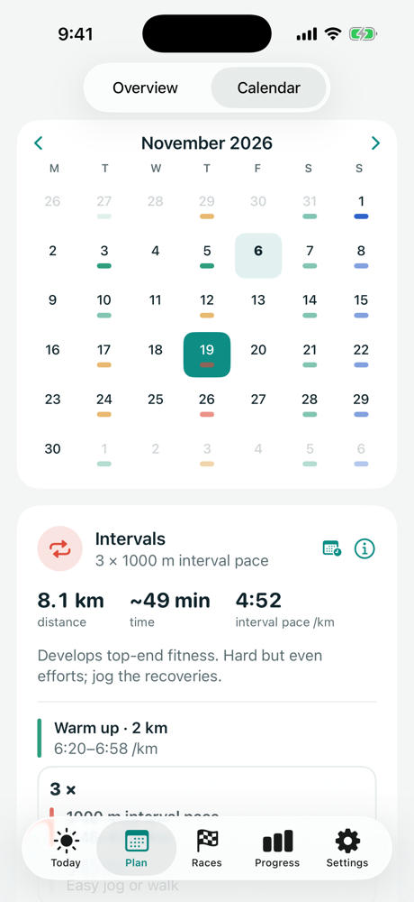
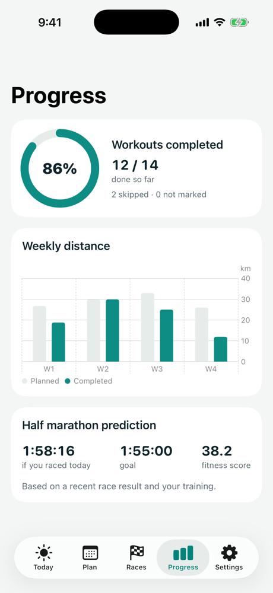

# TrackStar

**A free, open-source running coach for iPhone.** Personal training plans for 5K to marathon that adapt
to the running you actually do, with structured workouts sent straight to Apple Watch.

No accounts. No servers. No ads. No tracking. Your data stays on your phone and in your own iCloud.


<p>
  
  
  
  
</p>

## What it does

- **A plan built for you.** Pick a race (5K, 10K, half or full marathon), a date, your current fitness
  and the days you can run. The app builds a periodised plan: base, build, peak and taper.
- **Today's workout, step by step.** Warm-up, intervals or tempo blocks, recoveries and cool-down, each
  with a target you can show as pace, heart rate (bpm and zone) or treadmill speed (km/h or mph). Heart-rate
  zones come from your Garmin or other watch through Intervals.icu, or you can set your own.
- **Send to Apple Watch.** Workouts appear in the Workout app with every step and pace alerts.
- **Send to Garmin, COROS, Suunto and Wahoo.** Sign in to Intervals.icu (free) and link your watch there
  once; your upcoming workouts are kept in step with your plan and reach your watch a few days ahead.
- **Adapts as you go.** Runs from Apple Health tick workouts off automatically. Miss a few runs, take a
  break, run faster or slower than planned, change your race date or your free days, and the rest of the
  plan adjusts. It never tries to make you "catch up".
- **Starting from zero.** Can't run 30 minutes yet? The plan starts with three run/walk sessions a week and
  builds you to 30 minutes non-stop (about nine weeks) before training for your race.
- **Holidays, busy weeks, injury and illness.** Mark time off and the plan clears those days, shrinks those
  weeks and, after a week or more away, eases you back in. Injured with no end date? The plan pauses until you
  tap I'm better, then starts with an easy week.
- **Help built in.** A searchable how-to guide in Settings, which the coach also uses to answer "how do I…?".
- **Strides, hills and optional strength.** Easy runs finish with strides, base weeks include hill repeats, and
  short bodyweight strength routines can be turned on in Settings.
- **Share your run.** A clean image of the session, splits and heart-rate zones for Strava, Instagram or a
  message, made on the phone.
- **An optional coach.** Ask about your plan and runs ("How did my long run go?", "I'm tired today"). It uses
  Apple Intelligence on your iPhone (iOS 26 and later, on supported iPhones), so nothing leaves your phone. It
  can suggest moving or skipping a run; only you can make the change.
- **Run analysis.** Splits, pace and heart-rate charts, heart-rate zones, cadence and power, how each run
  compared with the plan, and plain-English notes. From Apple Health, or from Intervals.icu for the full
  recording from Garmin and other watches.
- **Calendar, races and progress.** Move workouts within a week, track other races and results, see
  completion, weekly distance and a predicted race time.
- **Works with your watch.** Apple Watch, Garmin, Coros and anything else that saves runs to Apple Health.
- **Your data is yours.** Export everything as JSON at any time, and import it again.

### Why Intervals.icu for Garmin?

Garmin only lets approved business partners send workouts to Garmin Connect, and its developer program
was closed to new applications for most of 2026. The Garmin Connect iPhone app has no way for other apps
to add workouts either. Intervals.icu is an approved Garmin partner (and COROS, Suunto and Wahoo), and
its sign-in works straight from the iPhone, so the app can use it without a server of its own. If Garmin
approves the app directly, a one-step "Connect Garmin" will replace it.

### Why not Strava?

Strava's API now charges developers, and new apps need Strava's approval before more than a handful of
athletes can connect. Most watches that sync to Strava can also sync to Apple Health, so the app reads
from Health instead. That keeps the app free and server-free.

## How plans are built

Plans come from transparent rules, not AI:

- Paces come from a recent race result, using published exercise-science equations.
- Weekly distance grows gradually, with easier weeks every three or four weeks.
- Hard days are kept apart, and at most a fifth of your running is fast.
- The plan tapers before race day.

Every rule is written up in plain English in [docs/PLAN-RULES.md](docs/PLAN-RULES.md).

The engine is a standalone Swift package ([`Packages/PlanEngine`](Packages/PlanEngine)) with no UI or Apple
framework dependencies. A safety validator checks every plan against every rule. The test suite generates
more than 10,000 plans and adapts thousands of them under simulated missed runs, breaks and schedule
changes, and requires every result to pass.

How do the plans compare with published coaching methods? [docs/PLAN-BENCHMARK.md](docs/PLAN-BENCHMARK.md)
measures generated plans against ranges from Daniels, Pfitzinger, Higdon and sports-science research, lists
where TrackStar falls short, and includes a review kit for a qualified coach.

## Privacy

- **No servers, no accounts, no analytics or tracking SDKs.** The app doesn't send data anywhere unless you
  connect Intervals.icu, in which case your upcoming workouts (and nothing else) go to your own Intervals.icu
  calendar. The sign-in is stored in the iPhone's Keychain.
- **Apple Health is read-only.** The app reads running workouts and distance, and never writes to Health.
- **iCloud sync** (when enabled) uses your private iCloud database, which only you can read.
- **Crash reports** stay on the phone: after a crash the app offers to email the report, and only sends it if
  you do. Apple's own crash sharing applies too, if you've opted in on your device.

The full [privacy policy](PRIVACY.md) has the details.

## Not medical advice

This app gives general training guidance, not medical advice. Talk to a doctor before starting a new
training programme. Stop and get advice if you feel pain, dizziness or chest discomfort.

## Building it

Requirements: Xcode 26 or later, iOS 17 or later (a device is needed for Apple Watch and real Health data).

```bash
open TrackStar.xcodeproj
```

Run the plan engine's tests (they run on a Mac, no simulator needed):

```bash
cd Packages/PlanEngine && swift test
```

Run the app's tests:

```bash
xcodebuild test -project TrackStar.xcodeproj -scheme TrackStar -destination 'platform=iOS Simulator,name=iPhone 17 Pro'
```

In debug builds, launch with the `-demo` argument to start with a sample plan part-way through (stored in
memory only).

### Configuration

Identity and capabilities live in [`Config/App.xcconfig`](Config/App.xcconfig):

| Setting | What it does |
|---|---|
| `APP_DISPLAY_NAME` | The name shown on the home screen. |
| `BUNDLE_ID_PREFIX` | Your reverse-domain prefix. The bundle ID becomes `<prefix>.runcoach`. |
| `DEVELOPMENT_TEAM` | Your Apple Developer team ID. Needed to run on a device; a free Apple ID works. Put it in `Config/Local.xcconfig` (copy `Config/Local.xcconfig.example`), which isn't committed. |
| `INTERVALS_CLIENT_ID` | The client ID of your Intervals.icu OAuth app, for "Sign in with Intervals.icu". Register at intervals.icu/oauth/apply, mark it as a public client, and add the redirect URI `<bundle ID in lower case>://intervals-oauth`. Leave blank to connect with a personal API key instead. |
| `ENABLE_ICLOUD` | Set to `YES` to sync through iCloud. Needs a team ID and the iCloud container `iCloud.<prefix>.runcoach` registered in your developer account. |

### Project layout

```
App/                 SwiftUI app (iOS 17+)
  Features/          Onboarding, Today, Plan + Calendar, Races, Progress, Settings
  Services/          Apple Health (read), Apple Watch (WorkoutKit), Intervals.icu, reminders
  Persistence/       SwiftData models (CloudKit-ready) and the app model
AppTests/            App tests: storage, adaptation, Health matching, Watch conversion
Packages/PlanEngine/ The rules-based plan engine, with its own tests
Config/              Build settings, entitlements
Design/              App icon source (drawn in code)
docs/                Plan rules, screenshots
```

## Roadmap

These are planned but not in v1:

- **Direct Garmin Connect sync,** if Garmin approves the app for its Training API.
- **Widgets and Live Activities** for today's workout.

## Contributing

Contributions are welcome. See [CONTRIBUTING.md](CONTRIBUTING.md) for what fits the project. This app is
maintained in my spare time, so there are no support guarantees and replies may be slow.

## Licence and trademarks

The source code is released under the [MIT licence](LICENSE).

**The app's name, logo and icon are not covered by the licence.** You're welcome to fork the code, but
please publish your fork under a different name and icon, so people don't confuse it with the official
app.
